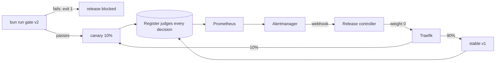

# Part 4: Release safely

## After this part you can

- Block a bad release with a gate of evals.
- Send a new release to a small share of residents first.
- Keep each run on the release it started on.
- Roll a bad canary back with nobody at the keyboard.
- Hand the person on call a runbook.

## You leave with

A release process for the permit desk. A `release-note.md` names the alert that would roll your release back.

## The problem

The planning team wants a friendlier prompt. The second release reads well. But its prompt tells the agent "a missing fee is fine".

For example, HDC-2026-0142 has paid nothing of a £578 fee. The first release asks for "The application fee of £578". The second writes `valid_awaiting_officer`. Its letter says "It has everything we need, and no fee is needed."

Today a new prompt goes to every resident at once. The only way back is that someone notices and deploys the old release by hand.

Four terms to know:

- An eval is a test of the agent's answers on fixed cases.
- A gate runs the evals. It blocks a release that fails them.
- A canary is a new release that a small share of residents get first. Here it is 10%.
- A runbook is a page of steps that a person follows when something goes wrong.

Here is the road a release now takes:



Notice: A bad release is stopped twice. The gate blocks it first. If it still gets out, the alert turns it off.

Anthropic found this out the hard way. In one month, three bugs made Claude's answers worse. At the worst hour, one of them hit 16% of Sonnet 4 requests. Anthropic now runs quality evals all the time on its real systems ([Anthropic Engineering, "A postmortem of three recent issues"](https://www.anthropic.com/engineering/a-postmortem-of-three-recent-issues)).

Anthropic also ships agent updates slowly. Old and new releases run side by side for a while ([Anthropic Engineering, "How we built our multi-agent research system"](https://www.anthropic.com/engineering/built-multi-agent-research-system)).

## Steps

| Step                        | You make                                                  | You know it works when                                              |
| --------------------------- | --------------------------------------------------------- | ------------------------------------------------------------------- |
| `gate-with-evals`           | A gate that runs 30 fixed applications                    | It passes the first release and fails the second                    |
| `ship-a-canary`             | A stable desk, a canary desk and one release file         | The stable desk serves 80 to 100 percent of 200 requests            |
| `pin-runs-to-their-release` | A router that keeps each run on the release it started on | A run in flight keeps its release when the weights change           |
| `roll-back-automatically`   | An alert on wrong decisions and a route to the controller | `bun run chaos bad-canary` ends with the canary at 0%, no key press |
| `write-the-runbook`         | `runbook.md` with six sections, linked from every alert   | The kill switch stops all model calls in under 10 seconds           |

## Walkthrough

Start the world and stop the finished desk. It uses the same container names as your desk.

```bash
bun run world
bun run down
```

Expect: `The world is running. Model provider: replay.` and `The desks are stopped. The world is still running.`

### gate-with-evals

Work in `01-gate-with-evals/problem/`. Write the checks in `evals/checks.ts` and the exit code in `gate.ts`.

```bash
cd parts/04-release-safely/01-gate-with-evals/problem
bun run gate v1
bun run gate v2
```

Expect: `Release v1 may ship.`, then six `FAIL` lines and `Release v2 is blocked.`

```bash
bun run verify gate-with-evals
```

Expect: `Done. All 5 rules pass.`

### ship-a-canary

Work in `02-ship-a-canary/problem/`. Split the desk into `desk-stable` and `desk-canary`, and put Traefik in
front.

```bash
cd ../../02-ship-a-canary/problem
docker compose up -d --build --wait --remove-orphans
for i in $(seq 20); do curl -s localhost:3000/healthz; echo; done | sort | uniq -c
```

Expect: about 18 answers with `"version":"v1"` and about 2 with `"version":"v3"`.

```bash
bun run verify ship-a-canary
```

Expect: `Done. All 5 rules pass.`

### pin-runs-to-their-release

Work in `03-pin-runs-to-their-release/problem/`. You do not need Docker for this step.

```bash
cd ../../03-pin-runs-to-their-release/problem
bun run verify pin-runs-to-their-release
```

Expect: `Done. All 6 rules pass.`

### roll-back-automatically

Work in `04-roll-back-automatically/problem/`. Write the alert rule and the route to the controller.

```bash
cd ../../04-roll-back-automatically/problem
docker compose up -d --build --wait
bun run drill v2
```

Expect: `Alert ReleaseDisagreesWithRules fired for release v2.` and the line below.

```text
Rolled back to 0%
```

```bash
bun run verify roll-back-automatically
```

Expect: `Done. All 5 rules pass.`

### write-the-runbook

Work in `05-write-the-runbook/problem/`. Fill in `runbook.md` and link each alert to it.

```bash
cd ../../05-write-the-runbook/problem
bun run verify write-the-runbook
```

Expect: `Done. All 5 rules pass.`

### The whole part

```bash
bun run verify part release-safely
```

Expect: `Part release-safely is done: 5/5 steps pass.`

The passing table looks like this:

    Part release-safely:
      PASS   gate-with-evals  (5/5 rules)
      PASS   ship-a-canary  (5/5 rules)
      PASS   pin-runs-to-their-release  (6/6 rules)
      PASS   roll-back-automatically  (5/5 rules)
      PASS   write-the-runbook  (5/5 rules)

## Watch and read

| Kind  | Title                               | Made by                                  | Why                                                                         | Link                                                                        |
| ----- | ----------------------------------- | ---------------------------------------- | --------------------------------------------------------------------------- | --------------------------------------------------------------------------- |
| read  | A postmortem of three recent issues | Anthropic Engineering                    | A real case of quality falling in production, and why ongoing evals matter. | <https://www.anthropic.com/engineering/a-postmortem-of-three-recent-issues> |
| read  | Canarying Releases                  | Google Site Reliability Engineering team | The team that runs Google's services explains how to judge a canary.        | <https://sre.google/workbook/canarying-releases/>                           |
| video | LLM Evals: Common Mistakes          | Hamel Husain, who teaches AI evals       | A maker of an evals course shows how to test an agent on fixed cases.       | <https://www.youtube.com/watch?v=GL0XhAj5LPE>                               |
| video | The Fine Art of Canary Deployments  | Daniel Hinojosa                          | A conference talk that shows a canary release step by step.                 | <https://www.youtube.com/watch?v=7dEumfFkQbU>                               |
| read  | Your AI Product Needs Evals         | Hamel Husain                             | A plain guide to writing the fixed cases and checks behind your gate.       | <https://hamel.dev/blog/posts/evals/>                                       |

## Project

The planning team wants the third release live. Last time, the second release told residents that a missing fee was fine. Show that the third is safe, and that the desk would undo it if it were not.

Hand in a branch or pull request on your fork with:

- `releases/v3.json`, the release you ship;
- the output of `bun run gate v3` and `bun run gate v2`;
- the output of `bun run drill v3` and `bun run drill v2`;
- `release-note.md`, one page: what changed, the gate result, the canary result and the rollback plan.

Each question is graded yes or no:

1. Does `bun run verify part release-safely` pass?
2. Does the gate pass the third release and still block the second, with the failing case ids printed?
3. Does every run the canary served carry the third release's id in its `release.id`?
4. Does the release note name the alert that would roll the third release back, and link its runbook heading?
5. Does the runbook's kill switch stop all model calls within 10 seconds when you run it?

Then do the same on your own work. Write 10 fixed cases for one prompt or setting you use, with the answers you expect. Make a script that exits with code 1 when any case fails. Write a short runbook with a kill switch that stops the paid calls.

## What comes next

The last part, `go-further`, is optional. It shows a new release real traffic without letting it answer anyone. That is called a shadow. Then it puts the desk on a container host with a public address.
