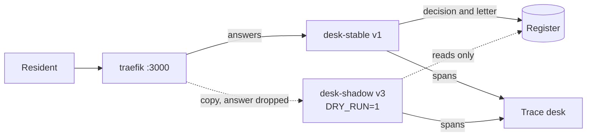
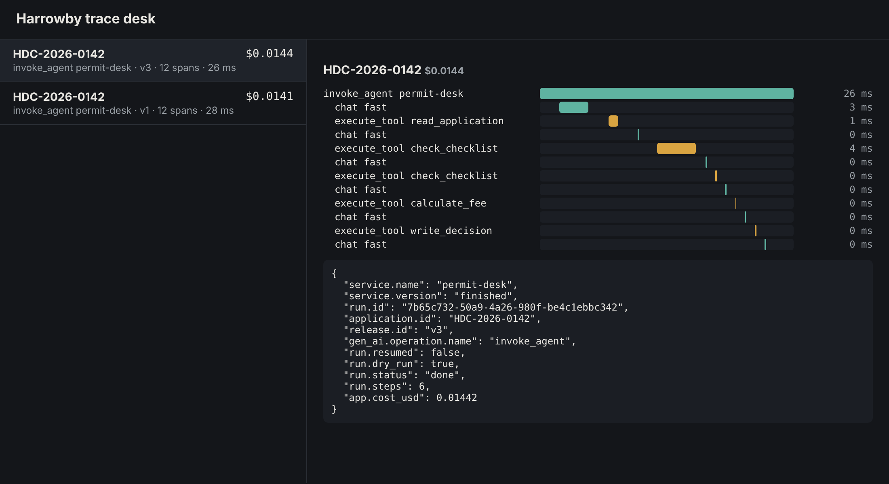

# Shadow the canary

## The problem

A canary still lets real residents read the new release's letters. For a risky change, even 10% is too many.
You want to see how v3 handles real requests before any resident reads one of its answers.

A shadow is a release that gets a copy of every request. Traefik sends the copy and drops the shadow's
answer. The resident only ever sees stable's answer.

But a copy of a request is still a real request. If the shadow writes its decision to the register, it races
stable. If it wins, its decision is the council's decision, and its letter goes to the resident.

For example, a resident checks HDC-2026-0142. Stable (v1) writes `invalid_missing_items` and asks for the
£578 fee. The shadow (v3) runs the same check as a dry run. A dry run reads the register but never writes to
it. Its trace shows what v3 would have decided, and the register holds only stable's decision.

## Your challenge

Today Traefik sends every request to `desk-stable`, and nothing else.

1. In `compose.yaml`, add `desk-shadow`, built from this folder like stable. Give it its own `/data` volume,
   `RELEASE_FILE: /app/releases/v3.json`, and `DRY_RUN: "1"`.
2. In `traefik/dynamic.yml`, make `desk` a mirroring service. Its main service is `stable`. It mirrors 100
   percent of requests to a `shadow` service at `http://desk-shadow:3000`.



Start it from this folder, then send one run:

```bash
bun run down
docker compose up -d --build --wait
curl -sN localhost:3000/v1/runs -H 'content-type: application/json' -d '{"application_id":"HDC-2026-0142"}' | tail -2
```

Expect: a `data:` line with `"status":"done"`. Then http://localhost:7004 shows two traces for HDC-2026-0142, one
for `v1` and one for `v3`.



## Done when

- `compose.yaml` has the services `traefik`, `desk-stable` and `desk-shadow`.
- Every answer on http://localhost:3000 comes from stable.
- Out of 20 runs, stable traced all 20.
- The shadow traced a copy of all 20, under another release.
- The register holds one decision and one letter per run, all from stable, and refused none.

```bash
bun run verify shadow-the-canary
```

Expect: `Done. All 5 rules pass.`

## If you get stuck

- A weighted service shares requests. A mirroring service copies them. Only the mirror keeps the shadow's
  answers away from residents.
- Look for `decision_refused` in http://localhost:7001/audit. It means two desks raced to decide.
- Every request now runs twice, so a shadow doubles the model bill. Run it for a short time, on purpose.
- Compare with `../solution/` when you are done.

## Words you will use

- **Shadow**: a release that gets a copy of real requests and never answers anyone.
- **Mirroring**: Traefik's way of sending a copy of each request to a second service.
- **Dry run**: a run that reads real data and writes nothing.
- **Race**: two programs try to do the same write, and whichever comes first wins.
