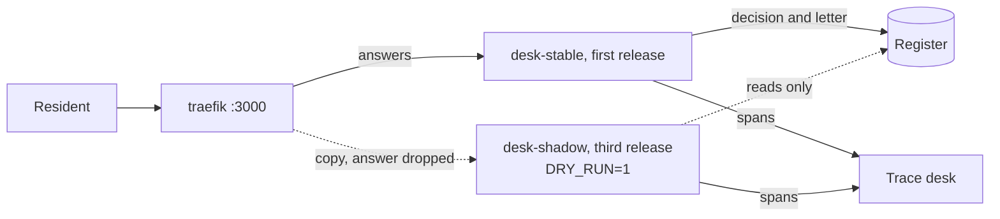
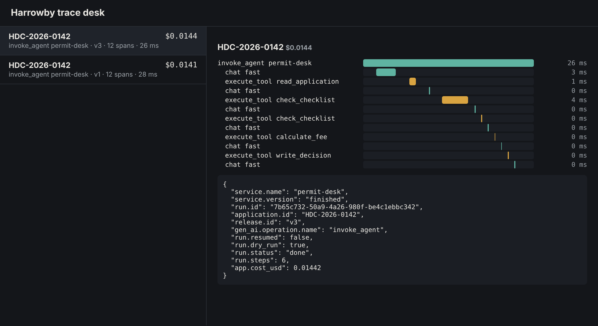

# Shadow the canary

## The problem

A canary still lets real residents read the new release's letters. A shadow does not: it gets a copy of each
request and its answer is dropped. But a copy is still a real request. For example, if the shadow writes to
the register, it races stable, and a resident can get the shadow's letter.

## Watch it done

Before, Traefik sends every request to `desk-stable` and nothing else. A resident checks HDC-2026-0142.
Stable writes `invalid_missing_items` and asks for the £578 fee.

After, the shadow gets a copy. A shadow is a release that gets copies and never answers anyone. It runs the
same check as a dry run. A dry run reads the register but never writes to it. Its trace shows what the third
release would have decided. The register holds only stable's decision.





## Your turn

1. In `compose.yaml`, add `desk-shadow`, built from this folder like stable. Give it its own `/data` volume,
   `RELEASE_FILE: /app/releases/v3.json`, and `DRY_RUN: "1"`.
2. In `traefik/dynamic.yml`, make `desk` a mirroring service. Its main service is `stable`. It mirrors 100
   percent of requests to a `shadow` service at `http://desk-shadow:3000`.
3. From the top of the repo, stop the other desks.

```bash
bun run down
```

Expect: `The desks are stopped. The world is still running.`

4. Start the shadow from this folder, then send one run.

```bash
cd parts/05-go-further/01-shadow-the-canary/problem
docker compose up -d --build --wait --remove-orphans
curl -sN localhost:3000/v1/runs -H 'content-type: application/json' -d '{"application_id":"HDC-2026-0142"}' | tail -2
```

Expect: a `data:` line with `"status":"done"`. Then http://localhost:7004 shows two traces for HDC-2026-0142, one
for `v1` and one for `v3`.

5. Run the check.

```bash
bun run verify shadow-the-canary
```

Expect: `Done. All 5 rules pass.`

## Do it on your work

Pick one change you want to try on your own service. Send a copy of its real requests to the new version, with
writes turned off. Good looks like two traces for each request, and no change in the data the users see. Run it
for a short time, because every request now runs twice.

## Done when

- `compose.yaml` has the services `traefik`, `desk-stable` and `desk-shadow`.
- Every answer on http://localhost:3000 comes from stable.
- Out of 20 runs, stable traced all 20.
- The shadow traced a copy of all 20, under another release.
- The register holds one decision and one letter per run, all from stable, and refused none.

## Solution

The after state is a `desk-shadow` service in `compose.yaml` and a mirroring service in
`traefik/dynamic.yml`. See `../solution/` for both files. Compare them with yours to see the diff.

## If you get stuck

- A weighted service shares requests. A mirroring service copies them. Only the mirror keeps the shadow's
  answers away from residents.
- Look for `decision_refused` in http://localhost:7001/audit. It means two desks raced to decide.
- Every request now runs twice, so a shadow doubles the model bill. Run it for a short time, on purpose.

## Words you will use

- **Shadow**: a release that gets a copy of real requests and never answers anyone.
- **Mirroring**: Traefik's way of sending a copy of each request to a second service.
- **Dry run**: a run that reads real data and writes nothing.
- **Race**: two programs try to do the same write, and whichever comes first wins.
