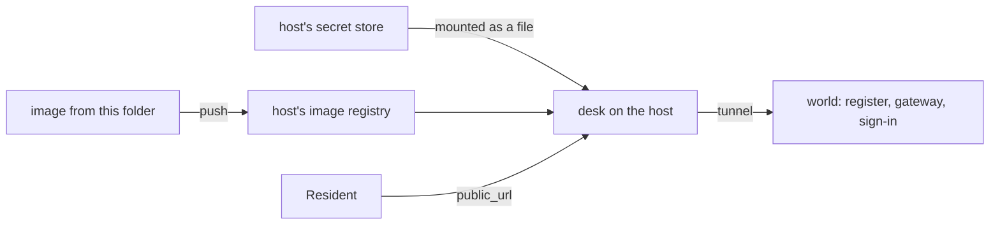

# Deploy to the cloud

## The problem

The desk runs on one laptop. When the laptop sleeps, residents get nothing. The council wants the desk on a
container host: a service that runs your image for you, gives it a public address, and keeps its secrets.

The image is the same. What changes is where the secrets come from and how the desk finds the rest of the
council. On your laptop, Docker Compose mounts the gateway key at `/run/secrets/gateway_key`. On a host, the
key lives in the host's secret store, and the host mounts it as a file.

For example, you store the desk's gateway key in the host's secret store as `desk-gateway-key`. The host
mounts it as a file. You set `GATEWAY_KEY_FILE` to that file's path. No key is in the image, in an
environment value, or in any file you commit.

## Your challenge

Pick any container host you can use. The steps are the same on each one.

1. Build the image from this folder and push it to the host's image registry.
2. Store the desk's gateway key, from `secrets/desk_gateway_key`, in the host's secret store. Mount it as a
   file, and set `GATEWAY_KEY_FILE` to its path. Do the same for `desk_client_secret`.
3. The desk must reach the world. Set `REGISTER_URL`, `GATEWAY_URL` and `IDP_URL` to addresses the host can
   reach. Set `PUBLIC_URL` to the host's address. For a short test, a tunnel from your laptop to ports 7001
   to 7003 works. Close it when you are done.
4. Write the host's address in `deploy.toml` as `public_url`.



Try the address before you run the check:

```bash
curl -s https://your-host-address/healthz
```

Expect: `{"status":"ok","version":"v1"}`

The sample solution points `public_url` at `http://localhost:3000`. The check then starts this folder's desk
on your machine, so it can run anywhere, CI included. Your own deploy points at the host.

## Done when

- `deploy.toml` names `public_url`.
- `<public_url>/healthz` answers 200 with the release version.
- Three runs stream token events, then a done event, the first event within 5 seconds.
- Each run left its decision and one letter in the register.
- Validate with no token answers 401 at the public address.
- No file in this folder holds a gateway key or the admin key.

```bash
bun run verify deploy-to-the-cloud
```

Expect: `Done. All 6 rules pass.`

## If you get stuck

- Many hosts set `PORT` for you. The desk listens on `PORT`, so check the value the host chose.
- If runs hang, the desk cannot reach the gateway or the register. Read the host's logs.
- Sign-in sends the browser to `ISSUER`. For staff sign-in on the host, the sign-in service needs a public
  address too. The check only needs the 401.
- Compare with `../solution/` when you are done.

## Words you will use

- **Container host**: a service that runs your container image and gives it an address.
- **Image registry**: a store for images that the host pulls from.
- **Secret store**: the host's place for keys. It hands a key to the container, never to the image.
- **Tunnel**: a program that gives a port on your laptop a public address for a while.
