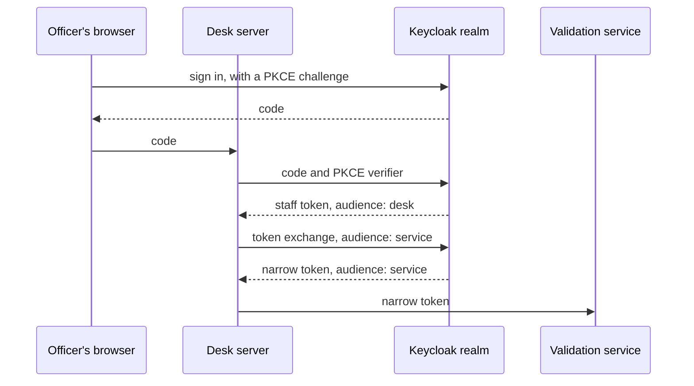

# Sign in with a real provider

## The problem

Staff sign in through a stand-in service on port 7003. We built it for this course. A real council runs a
sign-in system that many teams share.

In this step the desk signs in with Keycloak, a free sign-in system. It runs in your own compose file. It reads
a prepared realm: a set of users and apps.

For example, Amara Okafor opens the staff queue. The desk sends her to the realm's login page. She comes back
with a code. The desk swaps the code for a token and checks it with the realm's keys. Then the desk trades
her token for a smaller one before it calls the validation service. That token fits the service only.



## Your challenge

Work in this folder. The realm file `realm/council-realm.json` is ready. It holds the user `amara.okafor` and
three apps, called clients: `permit-desk` for the browser, `permit-desk-server` for the desk's server, and `permit-service`.

1. Write `compose.yaml` with a `keycloak` service. Use the image `keycloak/keycloak:26.8.2`. Mount `realm/` at
   `/opt/keycloak/data/import`. Run `kc.sh start-dev --import-realm`. Publish port 8080 as 8180. Pass the
   passwords as Compose secrets from `secrets/`, never on a command line.
2. In `src/desk-auth.ts`, write `startSignIn` and `finishSignIn` with the code flow and PKCE.
3. Write `verifyToken` with `jose`. It must check the signature, the issuer, the expiry and the audience.
4. Write `narrowToken`. It uses token exchange to get a token for `permit-service`.

Compare with `../solution/` when you are done. Start Keycloak, then read the realm's discovery document:

```bash
docker compose up -d --wait
curl -s http://localhost:8180/realms/council/.well-known/openid-configuration
```

Expect: JSON that holds `"issuer":"http://localhost:8180/realms/council"`.

## Done when

- The realm's discovery document answers.
- The realm refuses a sign-in request that has no PKCE challenge.
- A token from the officer's sign-in is accepted by the desk.
- An expired token and a token for another audience are refused.
- The narrowed token is accepted by the service and refused by the desk's own audience.

```bash
bun run verify sign-in-with-a-real-provider
```

Expect: `Done. All 5 rules pass.`

## If you get stuck

- Keycloak takes up to a minute to start. `docker compose logs keycloak` shows when it is ready.
- `Public client is not allowed to exchange token` means the exchange used the browser client. The desk's
  server must exchange with its own client and secret.
- `Requested audience not available` means the user has no role on that client. The realm file gives
  `amara.okafor` the role `validate` on `permit-service`.
- Run `bun run world` once if `secrets/` is missing.
- Stop Keycloak with `docker compose down -v` when you are done.

## Words you will use

- **Realm**: one set of users, clients and keys in Keycloak.
- **Code flow**: the browser signs in at the realm and brings back a code. The desk swaps it for a token.
- **PKCE**: a one-time secret that ties a code to the app that asked for it.
- **Audience**: the name of the service a token is made for. A service refuses a token for another audience.
- **Token exchange**: trading one token for a new one that fits fewer services.
