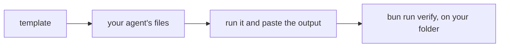

# Deploy your own agent

## The problem

Everything so far used the council's desk. The real test is your own agent, with your own files. A checklist
in your head does not prove it. Files and pasted output do.

For example, a learner pastes `$ curl -s http://localhost:3000/healthz` and the line it printed. That is
evidence. A sentence that says "it works" is not.

This step has no world. The check reads the folder you give it. It never looks at the course desk.

## Your challenge

Copy this `problem/` folder next to your own agent. It holds five files. Fill each one in for your agent.

1. **`Dockerfile`**: build your agent, run it as a user that is not root, and add a `HEALTHCHECK`.
2. **`compose.yaml`**: run it, and give it its key as a secret file. No key in `environment`.
3. **`release.json`**: the release id, `max_steps`, `max_cost_usd` and `timeout_ms`.
4. **`runbook.md`**: a real command or a real name under Kill switch, Roll back and Who to tell.
5. **`EVIDENCE.md`**: run the health check, a roll back and the kill switch on your agent. Paste each
   command after a `$ ` and its output below it. Add the date.



Run the check on your own folder:

```bash
bun run verify deploy-your-own-agent ../my-agent
```

Expect: `Done. All 6 rules pass.`

The check proves the shape and that the evidence exists. You prove that it is true, by running the commands.

## Done when

- The Dockerfile runs as a user that is not root and has a `HEALTHCHECK`.
- The key is a secret file, and no file holds something that looks like a real key.
- `release.json` has an id, a step limit, a dollar limit and a timeout.
- `runbook.md` has three sections, and none is empty.
- `EVIDENCE.md` has a date and real output for the health check, the roll back and the kill switch.

## If you get stuck

- A `TODO` left in a file fails that rule. Search for it.
- Does the key rule fail? The check looks for text such as `sk-` followed by a long key, and for a key name
  set in `environment`. Move the value to the secret file.
- Compare with `../solution/` for the shape. It is an example, not your agent.

## Words you will use

- **Evidence**: output you pasted from a real run, with the date.
- **Secret file**: a file that holds a key, kept outside the image and outside git.
- **Kill switch**: one command that stops every model call.
