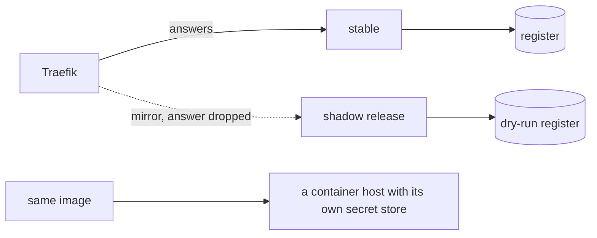

# Part 5: Go further (stretch)

## The problem

A canary still sends real residents to the new release. Some changes are too risky even for 10% of
residents. Also, so far the desk runs on one machine. The council wants to host it somewhere with a public
address.

In this part you try two things:

- Shadow traffic: a copy of each request goes to a new release, called the shadow. Residents never see the
  shadow's answer. It writes to a dry-run register, which is a practice copy, not the real register.
- A container host: a cloud service that runs your container image for you, with its own place for secrets.

For example, a resident sends HDC-2026-0142. The stable release answers the resident and writes to the real
register. The shadow gets the same request. Its decision goes to the dry-run register, and its answer is
thrown away.

## Why it matters

Anthropic keeps old and new versions of its agents running at the same time. It moves traffic to the new
version slowly. The reason is that an agent can be in the middle of its work when an update arrives.

The same post reports that agents use about 4 times more tokens than chat. A second copy of every request
doubles a bill that is already large
([Anthropic Engineering, "How we built our multi-agent research system"](https://www.anthropic.com/engineering/built-multi-agent-research-system)).



## Steps

| Step                  | Minutes | You make                                                                                         | The check reads                                                                                                    |
| --------------------- | ------- | ------------------------------------------------------------------------------------------------ | ------------------------------------------------------------------------------------------------------------------ |
| `shadow-the-canary`   | 25      | Traefik mirroring to a shadow release that writes to a dry-run register                          | shadow spans exist for every mirrored request; the register and letters show zero writes from the shadow           |
| `deploy-to-the-cloud` | 30      | the same image on a container host of your choice, with its secrets from the host's secret store | the `package-the-agent` stream checks pass against the public URL, and the staff route answers 401 without a token |

These steps are optional. Docker Compose on your laptop is the only required target in this course.

## Walkthrough

Start the world, and stop any desk that is running. The shadow uses the same container names as the other
desks.

```bash
bun run world
bun run down
```

Expect: `The world is running. Model provider: replay.` and `The desks are stopped. The world is still running.`

### shadow-the-canary

Work in `01-shadow-the-canary/problem/`. Add `desk-shadow` and turn Traefik's service into a mirror.

```bash
cd parts/05-go-further/01-shadow-the-canary/problem
docker compose up -d --build --wait
bun run verify shadow-the-canary
```

Expect: `Container hdc-desk-desk-shadow-1  Healthy`, then `Done. All 5 rules pass.`

### deploy-to-the-cloud

Work in `02-deploy-to-the-cloud/problem/`. Deploy the image to a host, then write its address in
`deploy.toml`.

```bash
cd ../../02-deploy-to-the-cloud/problem
docker compose down
bun run verify deploy-to-the-cloud
```

Expect: `Done. All 6 rules pass.` once `public_url` answers like the desk on your laptop.

### The whole part

```bash
bun run verify part go-further
```

Expect: `Part go-further is done: 2/2 steps pass.`

The passing table looks like this:

    Part go-further:
      PASS   shadow-the-canary  (5/5 rules)
      PASS   deploy-to-the-cloud  (6/6 rules)

## FINISHED

You can now try a new release on real traffic with no resident reading its answers. The shadow's traces show
what it would have decided, and the register holds only stable's decisions. You can also run the same image
on a container host, with its keys in the host's secret store and not in any file.

For example, a resident checks HDC-2026-0142. Stable asks for the £578 fee and writes one letter. The shadow's
trace shows that v3 would have asked for it too. That is your evidence before v3 ever goes on a canary.

This is the end of the course. Put the scorecard from `bun run verify --report` in your fork's README, with
the three numbers a reader looks for: the cost of one run, where the runaway run stopped, and how fast the bad
canary was rolled back.
