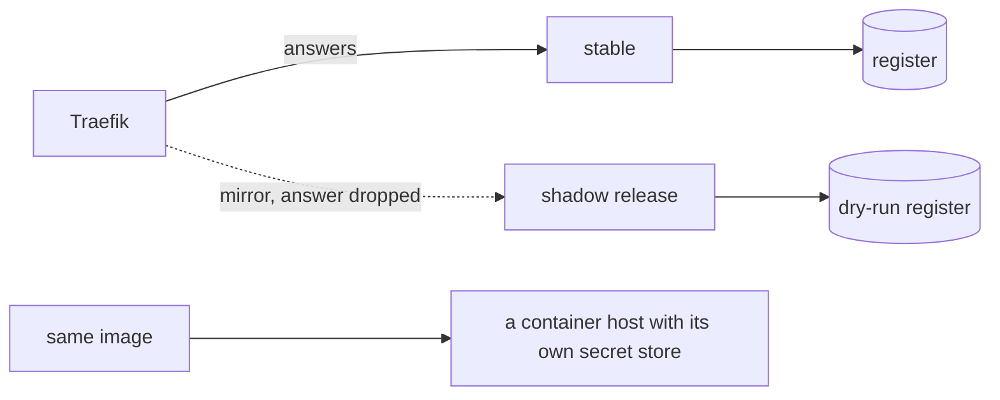

# Part 5: Go further (stretch)

## The problem

A canary still sends real residents to the new release. Some changes are too risky even for 10% of
traffic. And the desk so far runs on one machine, while the council will host it somewhere with a public
address.

## Why it matters

Anthropic keeps old and new versions of its agents running at the same time and shifts traffic gradually,
because agents may be anywhere in their process when an update lands. The same post reports that agents use
about 4 times more tokens than chat, so sending every request to a second copy doubles a bill that is already
large
([Anthropic Engineering, "How we built our multi-agent research system"](https://www.anthropic.com/engineering/built-multi-agent-research-system)).



## Steps

| Step                  | Minutes | You make                                                                                         | The check reads                                                                                                    |
| --------------------- | ------- | ------------------------------------------------------------------------------------------------ | ------------------------------------------------------------------------------------------------------------------ |
| `shadow-the-canary`   | 25      | Traefik mirroring to a shadow release that writes to a dry-run register                          | shadow spans exist for every mirrored request; the register and letters show zero writes from the shadow           |
| `deploy-to-the-cloud` | 30      | the same image on a container host of your choice, with its secrets from the host's secret store | the `package-the-agent` stream checks pass against the public URL, and the staff route answers 401 without a token |

These steps are optional. Docker Compose on your laptop is the only required target in this course.

## Walkthrough

TODO(part session): the commands for each step, each with its Expect line.

```bash
bun run verify part go-further
```

Expect: `Part go-further is done: 2/2 steps pass.`
