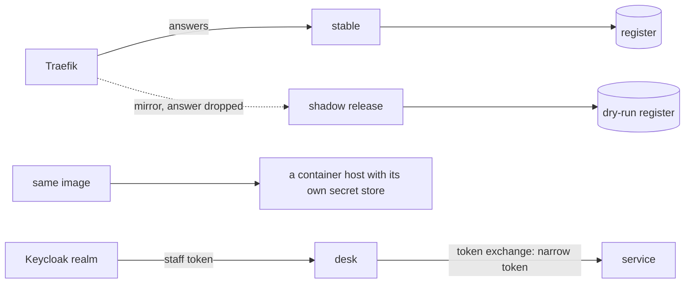

# Part 5: Go further (stretch)

## After this part you can

Copy real requests to a new release with no resident reading its answers. Run the same image on a container
host with its keys in a secret store. Sign staff in with Keycloak. Deploy your own agent with evidence.

## You leave with

A shadow release with its own dry-run register. A deploy address in `deploy.toml`. A Keycloak realm that the
desk signs in with. A folder of your own agent's deploy files, with pasted evidence.

## The problem

A canary still sends real residents to the new release. Some changes are too risky even for a small share of them. Also, the desk runs on one machine, and the council wants a public address.

For example, a resident sends HDC-2026-0142. The stable release answers and writes to the real register. The shadow gets the same request. Its decision goes to a dry-run register, which is a practice copy. Its answer is thrown away.

Anthropic runs old and new versions of its agents side by side. It moves traffic slowly, because an agent can be mid-work when an update arrives. The same post says agents use about 4 times more tokens than chat. A second copy of every request doubles a bill that is already large ([Anthropic Engineering, "How we built our multi-agent research system"](https://www.anthropic.com/engineering/built-multi-agent-research-system)).



## Steps

| Step                    | You make                                                                                                      | The check reads                                                                                                                          |
| ----------------------- | ------------------------------------------------------------------------------------------------------------- | ---------------------------------------------------------------------------------------------------------------------------------------- |
| `shadow-the-canary`     | Traefik mirroring to a shadow release that writes to a dry-run register                                       | shadow spans exist for every mirrored request; the register and letters show zero writes from the shadow                                 |
| `deploy-to-the-cloud`   | the same image on a container host of your choice, with its secrets from the host's secret store              | the `package-the-agent` stream checks pass against the public URL, and the staff route answers 401 without a token                       |
| `sign-in-with-keycloak` | a Keycloak service in compose, the desk's code flow with PKCE, token checks with `jose`, and a token exchange | the realm answers, a good token is accepted, an expired or wrong-audience token is refused, and the narrowed token fits only the service |
| `deploy-your-own-agent` | your own agent's Dockerfile, compose file, release.json, runbook and pasted evidence                          | the shape of your own folder, run with `bun run verify deploy-your-own-agent <folder>`; no course world                                  |

These steps are optional. Docker Compose on your laptop is the only required target in this course.

## Watch and read

| Kind  | Title                                                        | Made by               | Why                                                            | Link                                                                      |
| ----- | ------------------------------------------------------------ | --------------------- | -------------------------------------------------------------- | ------------------------------------------------------------------------- |
| video | Shadow Deployment: Mirror Live Traffic With Zero User Impact | Channel to confirm    | Shows the shadow idea before you set up the mirror.            | <https://www.youtube.com/watch?v=BKccKH-TzYI>                             |
| video | OAuth and OpenID Connect (in plain English)                  | Nate Barbettini, Okta | Explains the code flow that the Keycloak step uses.            | <https://www.youtube.com/watch?v=996OiexHze0>                             |
| read  | Traefik services, with the mirroring service                 | The Traefik Labs team | The exact settings for the copy that step one writes.          | <https://doc.traefik.io/traefik/routing/services/>                        |
| read  | Configuring and using token exchange                         | The Keycloak team     | Says how a staff token is traded for a narrower one.           | <https://www.keycloak.org/securing-apps/token-exchange>                   |
| read  | How we built our multi-agent research system                 | Anthropic Engineering | Shows why agents cost more tokens and why updates roll slowly. | <https://www.anthropic.com/engineering/built-multi-agent-research-system> |

## Project

Pick one change to your own service. Write the small plan that would send a copy of its real requests to the
new version with writes off. Name what you would compare and when you would stop the copy.

## Walkthrough

Start the world, and stop any desk that is running. The shadow uses the same container names as the other
desks.

```bash
bun run world
bun run down
```

Expect: `The world is running. Model provider: replay.` and `The desks are stopped. The world is still running.`

### shadow-the-canary

Work in `01-shadow-the-canary/problem/`. Add `desk-shadow` and turn Traefik's service into a mirror.

```bash
cd parts/05-go-further/01-shadow-the-canary/problem
docker compose up -d --build --wait
bun run verify shadow-the-canary
```

Expect: a Compose line that says `Healthy` for the shadow container, then `Done. All 5 rules pass.`

### deploy-to-the-cloud

Work in `02-deploy-to-the-cloud/problem/`. Deploy the image to a host, then write its address in
`deploy.toml`.

```bash
cd ../../02-deploy-to-the-cloud/problem
docker compose down
bun run verify deploy-to-the-cloud
```

Expect: `Done. All 6 rules pass.` once `public_url` answers like the desk on your laptop.

### Sign in with Keycloak

Work in `03-sign-in-with-keycloak/problem/`. Add Keycloak to compose, then write the desk's sign-in code.
The stand-in sign-in service on port 7003 stays. The earlier steps still use it.

```bash
cd ../../03-sign-in-with-keycloak/problem
docker compose up -d --wait
bun run verify sign-in-with-keycloak
docker compose down -v
```

Expect: `Done. All 5 rules pass.`

### The whole part

```bash
bun run verify part go-further
```

Expect: `Part go-further is done: 3/3 steps pass.`

The passing table looks like this:

    Part go-further:
      PASS   shadow-the-canary  (5/5 rules)
      PASS   deploy-to-the-cloud  (6/6 rules)
      PASS   sign-in-with-keycloak  (5/5 rules)

## FINISHED

You can now try a new release on real traffic with no resident reading its answers. The shadow's traces show
what it would have decided, and the register holds only stable's decisions. You can also run the same image
on a container host, with its keys in the host's secret store and not in any file.

For example, a resident checks HDC-2026-0142. Stable asks for the £578 fee and writes one letter. The shadow's
trace shows that the third release would have asked for it too. That is your evidence before it goes on a canary.

This is the end of the course. Put the scorecard from `bun run verify --report` in your fork's README. Add the three numbers a reader looks
for. They are the cost of one run, where the runaway run stopped, and how fast the bad canary was rolled back.
