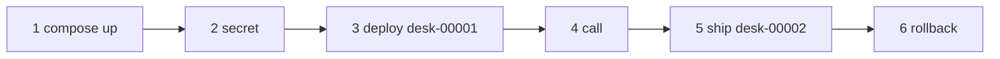

# Release on Cloud Run

## The problem

You have released the desk by hand. Now do it the way a cloud service does. Cloud Run keeps each change as a
numbered revision, like `desk-00001`. You can ask the service for any of them, and it serves one at a time.

You will use floci-gcp, a free emulator of Google Cloud. It needs no account or key.

For example, v2 turns out bad, and you need v1 back. The revisions will look like this:

```text
desk-00001  v1  deploy
desk-00002  v2  ship
desk-00003  v1  rollback
```

## Your challenge

Work in this `problem/` folder. First build the desk image that the emulator will run:

```bash
docker build -t hdc-desk:cloud-run ../../../05-go-further/02-deploy-to-the-cloud/solution
```

Expect: `naming to docker.io/library/hdc-desk:cloud-run`



Then do these six things:

1. **Start the emulator.** Fill in `docker-compose.yml`, then run `docker compose up -d`.
2. **Store the key.** In `release.ts`, put the fake key from `fake-key.txt` in Secret Manager as
   `desk-gateway-key`. Never use a real key.
3. **Deploy.** Create the Cloud Run service `desk` from the image, with release v1.
4. **Call it.** `bun release.ts call` prints the desk's health answer.
5. **Ship.** Change the template to release v2. That makes revision `desk-00002`.
6. **Roll back.** Get release v1 serving again. Try your idea on the emulator first. Believe only what
   you see it do.

```bash
docker compose up -d
bun release.ts deploy
bun release.ts call
```

Expect: `Deployed revision desk-00001.` and then `{"status":"ok","version":"v1"}`

```bash
bun release.ts ship
bun release.ts rollback
bun release.ts call
```

Expect: `Shipped revision desk-00002.`, then a rollback line, then `"version":"v1"` again.

The emulator cannot mount a Cloud Run secret as a file. So `release.ts` reads the secret from Secret Manager
at deploy time and gives it to the desk as a value. On real Cloud Run you would mount the secret instead.

## Done when

- `docker-compose.yml` runs `floci/floci-gcp:0.12.0` on port 4588.
- The fake key is in Secret Manager, and only in `fake-key.txt` in your files.
- `desk-00001` serves release v1, and `call` prints that answer.
- `desk-00002` serves release v2.
- After the rollback, release v1 serves again, and the service has three revisions.

```bash
bun run verify release-on-cloud-run
docker compose down -v
```

Expect: `Done. All 7 rules pass.`

## If you get stuck

- Hint: create a secret with `POST /v1/projects/floci-local/secrets?secretId=desk-gateway-key`. Then add a
  version with `:addVersion`. The key goes in `payload.data` as base64.
- Hint: create the service with `POST` on the `services?serviceId=desk` path under
  `/v2/projects/floci-local/locations/us-central1`. It is ready in about 5 seconds.
- Hint: a `GET` on `/run/v2/projects/floci-local/locations/us-central1/services/desk/healthz` calls the desk.
- Hint: a `PATCH` on the service path with a changed template makes a new revision.
- If the rollback prints but v2 still serves, the emulator did not apply your change. Call the desk.
- Go further: add a `status` command that lists the revisions.
- Compare with `../solution/` when you are done.

## Words you will use

- **Cloud Run**: a Google Cloud service that runs a container image and gives it an address.
- **Revision**: one saved copy of a service's template. Each change makes a new one.
- **Secret Manager**: the cloud's place for keys. You read a key from it, and never keep it in code.
- **Emulator**: a program on your machine that answers like a cloud service.
