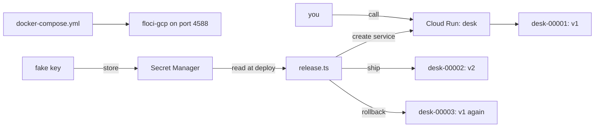

# Part 6: Deploy the agent to Cloud Run with floci-gcp

This part redoes the course's release with a cloud service, on your own machine. It is optional in the live
session and expected as homework. Nothing in parts 1 to 5 changes.

## The problem

In part 4 you built a release by hand: a canary, a check and a rollback, all with your own scripts. A real team
often runs the desk on a cloud service instead, such as Google Cloud Run. That service keeps the key in a secret
store, makes a new revision for every change, and serves one revision at a time.

You do not need a cloud account to learn this. [floci-gcp](https://github.com/floci-io/floci-gcp) is a free,
MIT-licensed emulator of Google Cloud. It runs as one Docker Compose service on port 4588. It needs no account
and no key.

For example, you change the desk from release v1 to v2. Cloud Run keeps the old revision, starts the new one,
and then serves the new one. If v2 is bad, you need a way back that you have already tried.

## Why it matters

A rollback you have never tried is a hope, not a plan. The emulator is a safe place to try it. It also tells you
what it cannot do. It does not apply a traffic setting, and it cannot mount a secret as a file. You learn
those limits here, so a cloud bill and a bad night do not teach them to you.

The emulator's own pages say what it supports:
[Cloud Run](https://github.com/floci-io/floci-gcp/blob/main/docs/services/cloud-run.md) and
[Secret Manager](https://github.com/floci-io/floci-gcp/blob/main/docs/services/secret-manager.md).



## What we teach

You write one Bun script, `release.ts`, that talks to the emulator's Cloud Run Admin API v2 and Secret Manager.
The desk image is the one from part 5. Only a fake key is used, never a real one.

| Step                                                              | Minutes | You make                                                                      | The check reads                                                                     |
| ----------------------------------------------------------------- | ------- | ----------------------------------------------------------------------------- | ----------------------------------------------------------------------------------- |
| [release-on-cloud-run](01-release-on-cloud-run/problem/README.md) | 30      | a Compose file, a secret, a service, a call, a second revision and a rollback | the pinned image, the secret, the three revisions and which release each one serves |

## Options

**The desk on Compose only, with scripts from part 4**

- **Choose when** one machine is enough and you want no cloud service to learn.
- **Trade-off:** you keep the revisions, the secret store and the rollback yourself.

Cloud Run is the better pick when you want the platform to keep revisions and hold the secrets.

## Walkthrough

The check builds the desk image if it is missing. Check the reference solution first, then the starter.

```bash
bun run verify release-on-cloud-run solution
```

Expect: `Done. All 7 rules pass.`

```bash
bun run assignment
```

Expect: `FAIL` lines with a `Try next:` sentence each, and `Not done yet.`, until you finish the step.

When the step passes, the whole part passes.

```bash
bun run verify part deploy-the-agent-to-cloud-run-with-floci-gcp
```

Expect: `Part deploy-the-agent-to-cloud-run-with-floci-gcp is done: 1/1 steps pass.`
