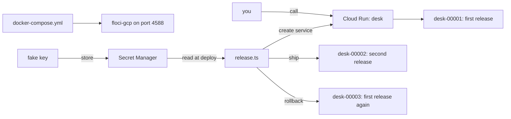

# Part 6: Deploy the agent to Cloud Run with floci-gcp

This part does the course's release again, on a cloud service, on your own machine. It is optional in the live session, and it is expected as homework. Nothing in parts 1 to 5 changes.

## After this part you can

- Store a key in a secret manager.
- Deploy a service as numbered revisions.
- Ship a change, and roll back to the first release.

You do all of it on an emulator, with no cloud account.

## You leave with

A working `release.ts` and `docker-compose.yml`. A `CHOICE.md` that says when Cloud Run is the better choice. A rollback you watched work.

## The problem

In part 4 you built a release by hand, with your own scripts. A real team often runs the desk on a cloud service such as Google Cloud Run. It keeps the key in a secret store. It makes a new revision for every change, and it serves one revision at a time.

You do not need a cloud account to learn this. [floci-gcp](https://github.com/floci-io/floci-gcp) is a free emulator of Google Cloud. It runs as one Docker Compose service on port 4588, and it needs no key.

For example, you change the desk from the first release to the second. Cloud Run keeps the old revision, starts the new one, and serves it. If the second release is bad, you need a way back that you have already tried. A rollback you have never tried is a hope, not a plan.

The emulator also tells you what it cannot do. It does not apply a traffic setting. It cannot mount a secret as a file. Its own pages say what it supports: [Cloud Run](https://github.com/floci-io/floci-gcp/blob/main/docs/services/cloud-run.md) and [Secret Manager](https://github.com/floci-io/floci-gcp/blob/main/docs/services/secret-manager.md).



## Steps

You write one Bun script, `release.ts`. It talks to the emulator's Cloud Run Admin API and Secret Manager. The desk image is the one from part 5. Only a fake key is used, never a real one.

| Step                                                              | You make                                                                      | The check reads                                                                     |
| ----------------------------------------------------------------- | ----------------------------------------------------------------------------- | ----------------------------------------------------------------------------------- |
| [release-on-cloud-run](01-release-on-cloud-run/problem/README.md) | a Compose file, a secret, a service, a call, a second revision and a rollback | the pinned image, the secret, the three revisions and which release each one serves |

## Watch and read

| Kind  | Title                                                           | Made by                   | Why                                                        | Link                                                                              |
| ----- | --------------------------------------------------------------- | ------------------------- | ---------------------------------------------------------- | --------------------------------------------------------------------------------- |
| video | Cloud Run Deployments: Revisions, Traffic Splitting, Blue/Green | Channel to confirm        | Shows revisions and traffic before you make your own.      | <https://www.youtube.com/watch?v=aZwXM3myz5U>                                     |
| video | Cloud Run Traffic Management Lab                                | Channel to confirm        | A hands-on run of deploying revisions and moving traffic.  | <https://www.youtube.com/watch?v=h0dBq5Ifq-o>                                     |
| read  | Rollbacks, gradual rollouts, and traffic migration              | The Google Cloud Run team | The real service's rollback, to compare with the emulator. | <https://docs.cloud.google.com/run/docs/rollouts-rollbacks-traffic-migration>     |
| read  | floci-gcp Cloud Run                                             | The floci-gcp maintainers | Says what the emulator supports and what it skips.         | <https://github.com/floci-io/floci-gcp/blob/main/docs/services/cloud-run.md>      |
| read  | floci-gcp Secret Manager                                        | The floci-gcp maintainers | Says how the emulator stores a key.                        | <https://github.com/floci-io/floci-gcp/blob/main/docs/services/secret-manager.md> |

## Project

Pick one small service of your own. Write its rollback as one command. Try it on a safe copy. Save what you saw in a short note.

## Options

**The desk on Compose only, with scripts from part 4**

- **Choose when** one machine is enough, and you want no cloud service to learn.
- **Trade-off:** you keep the revisions, the secret store and the rollback yourself.

Cloud Run is the better pick when you want the platform to keep revisions and hold the secrets.

## Walkthrough

The check builds the desk image if it is missing. Check the reference solution first, then the starter.

```bash
bun run verify release-on-cloud-run solution
```

Expect: `Done. All 7 rules pass.`

```bash
bun run assignment
```

Expect: `FAIL` lines with a `Try next:` sentence each, and `Not done yet.`, until you finish the step.

When the step passes, the whole part passes.

```bash
bun run verify part deploy-the-agent-to-cloud-run-with-floci-gcp
```

Expect: `Part deploy-the-agent-to-cloud-run-with-floci-gcp is done: 1/1 steps pass.`
